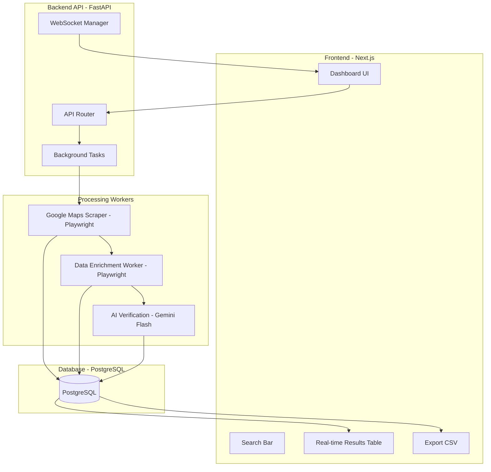
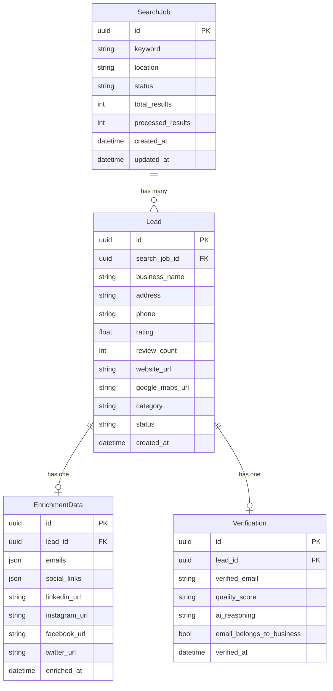

# 🚀 Lead Generation MVP — Implementation Plan

> **Project**: LeadScout — High-Speed Lead Generation Platform  
> **Inspired by**: Scout (BluTec.ai)  
> **Core Workflow**: Search → Extract → Enrich → Verify → Export

---

## 1. System Architecture



---

## 2. Tech Stack

| Layer | Technology | Purpose |
|-------|-----------|---------|
| **Backend API** | Python 3.12 + FastAPI | REST API + WebSocket for real-time updates |
| **Scraping** | Playwright (async) | Headless browser for Google Maps + website scraping |
| **Async Processing** | FastAPI BackgroundTasks + asyncio | Non-blocking scrape/enrich pipeline |
| **Database** | PostgreSQL | Persistent storage for leads, jobs, search history |
| **ORM** | Prisma (Python client) | Type-safe DB access from Python |
| **AI** | Google Gemini 2.0 Flash | Email verification and lead quality scoring |
| **Frontend** | Next.js 15 (App Router) | Dashboard, search UI, real-time table |
| **Styling** | Tailwind CSS v4 | Responsive, utility-first styling |
| **Icons** | Lucide React | Clean icon set |
| **State** | React Query / TanStack Query | Server-state management + polling |

---

## 3. Database Schema



**Status values:**
- `SearchJob.status`: `pending | scraping | enriching | verifying | completed | failed`
- `Lead.status`: `scraped | enriching | enriched | verified`
- `Verification.quality_score`: `hot | warm | cold`

---

## 4. Module Breakdown

### 4.1 — Scraper Service (`backend/services/scraper.py`)

| Responsibility | Details |
|----------------|---------|
| **Input** | Keyword + Location from API |
| **Process** | Launch Playwright → Navigate to Google Maps → Search → Scroll results → Extract business cards |
| **Output** | List of `Lead` records (name, rating, phone, address, website, maps URL) |
| **Anti-Detection** | Random delays, realistic viewport, user-agent rotation, stealth plugin |
| **Rate Limiting** | Max 1 concurrent scrape job per user, 3-5s delay between scrolls |

### 4.2 — Enrichment Service (`backend/services/enricher.py`)

| Responsibility | Details |
|----------------|---------|
| **Input** | Lead records with `website_url` |
| **Process** | Visit each website → Regex + DOM parse for emails, social links |
| **Patterns** | `mailto:` links, common email patterns, `/contact` page crawling |
| **Social** | Extract LinkedIn, Instagram, Facebook, Twitter URLs |
| **Concurrency** | Up to 5 parallel browser contexts for speed |

### 4.3 — Verification Service (`backend/services/verifier.py`)

| Responsibility | Details |
|----------------|---------|
| **Input** | Lead + Enrichment data |
| **Process** | Send to Gemini Flash with structured prompt |
| **Output** | `email_belongs_to_business` (bool), `quality_score` (hot/warm/cold), `reasoning` |
| **Prompt Design** | Provide business name, category, website domain, and extracted email. Ask Gemini to assess match likelihood |

### 4.4 — API Layer (`backend/api/`)

| Endpoint | Method | Description |
|----------|--------|-------------|
| `/api/search` | POST | Start a new search job (keyword + location) |
| `/api/search/{id}` | GET | Get job status + leads |
| `/api/search/{id}/leads` | GET | Paginated leads for a job |
| `/api/search/{id}/export` | GET | Download CSV of leads |
| `/api/jobs` | GET | List all search jobs |
| `/api/ws/{job_id}` | WS | Real-time updates via WebSocket |

### 4.5 — Frontend (`frontend/`)

| Page/Component | Description |
|----------------|-------------|
| **Dashboard** (`/`) | Search bar + recent jobs list |
| **Job View** (`/job/[id]`) | Real-time results table with status badges, lead cards |
| **Search Bar** | Keyword + Location inputs, submit button |
| **Results Table** | Sortable, filterable table with business info, emails, quality scores |
| **Export Button** | CSV download with all enriched/verified data |
| **Progress Indicator** | Animated progress bar + status text |

---

## 5. Phased Delivery Plan

### Phase 1: The Scraper ⛏️
> **Goal**: Search Google Maps and populate a database with business listings.

- [ ] Project scaffolding (backend + frontend mono-repo)
- [ ] PostgreSQL + Prisma schema setup
- [ ] FastAPI app with health check
- [ ] Playwright scraper for Google Maps
- [ ] Anti-detection measures (stealth, delays, viewport)
- [ ] `/api/search` POST endpoint + background task
- [ ] `/api/search/{id}` GET endpoint for results
- [ ] **Browser verification**: Test "Dentists in Mumbai" search
- [ ] Basic Next.js dashboard with search bar and results table

### Phase 2: The Enricher 🔍
> **Goal**: Visit each lead's website and extract contact info.

- [ ] Enrichment worker with Playwright
- [ ] Email extraction (regex + DOM parsing)
- [ ] Social media link extraction
- [ ] Contact page auto-discovery (`/contact`, `/about`)
- [ ] Concurrent enrichment (5 parallel contexts)
- [ ] Update results table with enrichment data
- [ ] WebSocket real-time updates

### Phase 3: AI Verification 🤖
> **Goal**: Use Gemini to verify emails and score leads.

- [ ] Gemini API integration
- [ ] Verification prompt engineering
- [ ] Quality scoring (hot/warm/cold)
- [ ] Email-to-business matching
- [ ] Verification results in UI
- [ ] Lead quality badges and filters

### Phase 4: Polish & Export ✨
> **Goal**: Production-ready MVP with export and UX polish.

- [ ] CSV export with all data columns
- [ ] Search history / job management
- [ ] Error handling & retry logic
- [ ] Rate limiting & queue management
- [ ] UI animations & loading states
- [ ] Responsive design
- [ ] Documentation

---

## 6. Project Structure

```
g map scraping/
├── backend/
│   ├── main.py                    # FastAPI app entry
│   ├── config.py                  # Environment config
│   ├── requirements.txt
│   ├── prisma/
│   │   └── schema.prisma          # Database schema
│   ├── api/
│   │   ├── __init__.py
│   │   ├── routes.py              # API endpoints
│   │   └── websocket.py           # WebSocket handler
│   ├── services/
│   │   ├── __init__.py
│   │   ├── scraper.py             # Google Maps scraper
│   │   ├── enricher.py            # Website data enrichment
│   │   └── verifier.py            # Gemini AI verification
│   ├── models/
│   │   ├── __init__.py
│   │   └── schemas.py             # Pydantic models
│   └── utils/
│       ├── __init__.py
│       ├── stealth.py             # Anti-detection utilities
│       └── parsers.py             # Email/social parsers
├── frontend/
│   ├── package.json
│   ├── next.config.js
│   ├── tailwind.config.js
│   ├── src/
│   │   ├── app/
│   │   │   ├── layout.tsx
│   │   │   ├── page.tsx           # Dashboard
│   │   │   └── job/
│   │   │       └── [id]/
│   │   │           └── page.tsx   # Job detail view
│   │   ├── components/
│   │   │   ├── SearchBar.tsx
│   │   │   ├── ResultsTable.tsx
│   │   │   ├── LeadCard.tsx
│   │   │   ├── ProgressBar.tsx
│   │   │   └── ExportButton.tsx
│   │   └── lib/
│   │       ├── api.ts             # API client
│   │       └── types.ts           # TypeScript types
│   └── public/
├── docker-compose.yml             # PostgreSQL + app
└── README.md
```

---

## 7. Key Technical Decisions

| Decision | Rationale |
|----------|-----------|
| **FastAPI BackgroundTasks** over Celery | Simpler for MVP, no Redis/RabbitMQ dependency. Can migrate to Celery later. |
| **Playwright** over Selenium | Faster, better async support, built-in stealth capabilities |
| **WebSocket** for real-time | Instant UI updates as leads are scraped/enriched, no polling needed |
| **Prisma Python** | Type-safe queries, auto-generated client, easy migrations |
| **Gemini Flash** | Fast inference, cost-effective for classification tasks |
| **TanStack Query** | Automatic caching, background refetch, optimistic updates |

---

## 8. Anti-Detection Strategy

1. **Stealth Playwright** — Patch navigator properties, WebGL, canvas fingerprint
2. **Random delays** — 2-5s between actions, human-like scroll patterns
3. **Viewport variation** — Randomize window size within realistic ranges
4. **User-Agent rotation** — Pool of 10+ current Chrome UAs
5. **Session isolation** — Fresh browser context per job
6. **Proxy support** — Optional proxy configuration for high-volume use
